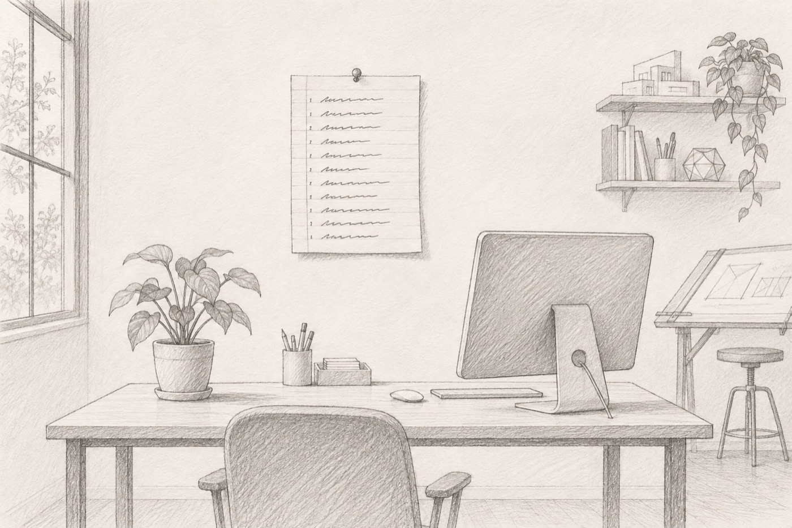

# Part 1: First words

<figure markdown="span">
  
  <figcaption>Oskar's sheet, with its eleven lines.</figcaption>
</figure>

Oskar leaves Halfmoon Type on a Friday and hands Mira a list of eleven chores. She has never written a line of code.

In this part you sit next to her. You find the place in FontLab where Python goes, run one line, and break it on purpose so that red text stops being frightening. Then you start asking the font questions: how many glyphs it has, what each one is called, how wide it is, which ones are still empty.

You need no Python and no programming background. By the last chapter of the part you will have a script that writes a short report about any font you open, and the first four chores on Oskar's list will be done.

This part is being written. Its chapters appear in the menu as they are finished.
