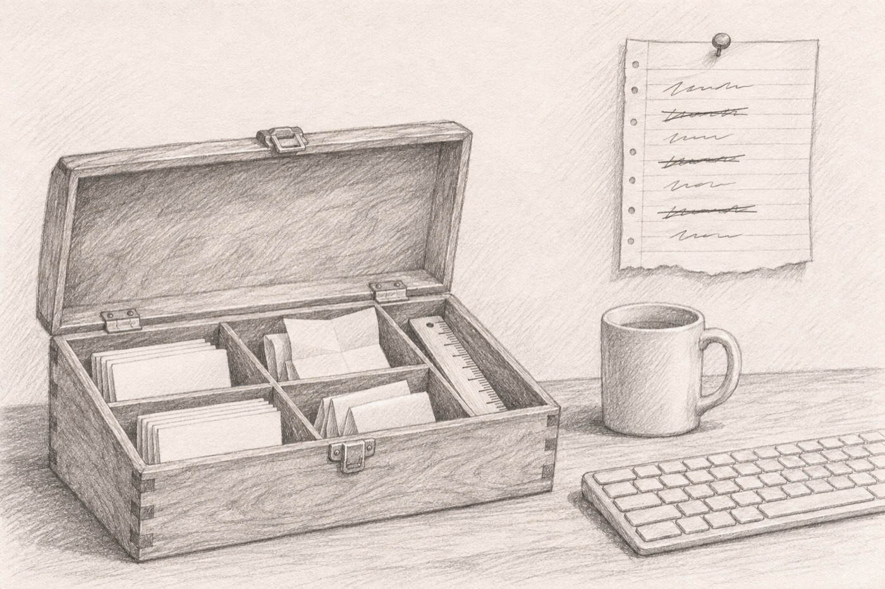

# Part 2: A toolbox

<figure markdown="span">
  
  <figcaption>A box for the things you'll want again.</figcaption>
</figure>

The chores pile up. Mira builds a toolbox of her own.

In Part 1 you asked a font questions, one glyph at a time, and read the answers in the Output panel. That is enough for a count. It isn't enough when Ines wants the answer as a file, when the publisher sends a list of characters, or when a change has to be taken back.

This part gives you the tools for that. You learn the dictionary, which looks things up by name, and use it to count and to find the glyph for a letter. You write a report to a file, read a list from a file, and make tables a spreadsheet can open. You change a glyph and undo the change, rename with care, and tag and mark glyphs so that people can find them.

Then you start keeping what you write. You learn how Python finds modules, and you gather your best functions into a set of snippets that you can paste into any script. You sort tables by any column, read a traceback without alarm, and make a script ask before it acts.

Oskar's sheet waits through these four weeks. The chores come from Ines, from Tomas and from the publisher, and the sheet still has four lines crossed out and seven open when the part ends. What changes is that you now have the tools for the seven.

You need the practice copy of Plum from Part 1 and Fly installed in FontLab 9.
