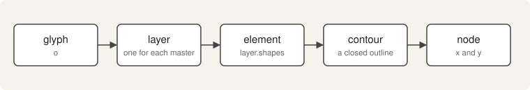

# 41. Inside a glyph

Monday of the eighth week. Mira has Oskar's sheet in front of her and reads the first line that isn't crossed out: *List the glyphs that are built from other glyphs.* She knows what it means as a designer. The `é` in Plum isn't drawn. It's an `e` and an acute accent, borrowed and put together. What she doesn't know is how a script would tell.

For seven weeks her scripts have treated a glyph like a parcel. They've read the label: the name, the Unicode value, the width, the color. Once, in chapter 8, they shook the parcel to hear whether it was empty. They've never opened it.

Today you'll open one. Double-click the `o` in the Font window, so that it fills a Glyph window, and look at it for a moment as a designer does. There's an outer oval and an inner oval, with small squares and circles sitting on them. Now let's find out what a script sees.

## What you need

- FontLab 9 with Fly installed, and `Plum-practice` open.
- The `o` open in a Glyph window, with the Regular master showing.
- Nothing else. The scripts in this chapter only read.

The outputs below were computed from Plum's source file, not copied from FontLab's Output panel. The calls come from the helpers' source.

## Step 1: Which drawing?

In chapter 29 you met the box that holds the glyph you're working on:

```python
from fly.tr.proxy.fl.objects.glyph import pGlyph

glyph = pGlyph()
layer = glyph.activeLayer()
print(glyph.name, layer.name)
```

```text
o Regular
```

`pGlyph()` with empty parentheses means "the glyph in the window I'm looking at". And `activeLayer()` hands you the layer that's showing.

It's time to say properly what a layer is. Plum comes in three weights, and so every glyph in it is drawn three times: a light `o`, a regular `o` and a bold `o`. Each of those drawings is a layer, and it carries the name of its master. All three live under the one name `o`. When you asked for `glyph.width` in Part 1, you were getting the width of one of them.

So "what's inside the glyph?" means "what's inside this layer of the glyph?" Every outline you read, from here to the end of Part 3, belongs to one layer. For now it's the one on your screen.

## Step 2: Contours

Ask the glyph for its contours:

```python
contours = glyph.contours()
print(len(contours))
```

```text
2
```

A contour is one closed line, the kind you could trace with a pencil without lifting it, ending where you began. The `o` has two: the outer oval and the inner one. What's black on the page is the space between them. `contours` is an ordinary list, so everything you know about lists works on it.

Be careful with the parentheses. Leave them off and see what happens:

```python
print(len(glyph.contours))
```

```text
TypeError: object of type 'method' has no len()
```

`glyph.name` has no parentheses, because it's a drawer with a value in it. `glyph.contours()` has them, because it's an action: go and collect the contours. Without the parentheses you're holding the action itself and not its result. That's the "function is a value" idea from chapter 36, and here it gets in your way. Python's complaint is exact: the thing you gave to `len` is a method, which is its word for a function that lives in an object's drawer, and a method has no length.

There's no rule that tells you which names want parentheses. This box, `pGlyph`, mostly wants them: `contours()`, `activeLayer()`, `getLSB()`. The plain glyph from `font.glyphs` mostly doesn't. When you get an error that mentions `'method'`, add the parentheses.

Now ask each contour two things:

```python
for contour in contours:
    print(contour.closed, len(contour.nodes()))
```

```text
True 12
True 12
```

`closed` is `True` when the line comes back to where it started. In a finished font every contour should be closed, and chapter 44 goes looking for the ones that aren't.

`nodes()` hands you the contour's points as a list, and it wants parentheses too. Each oval has twelve.

Look at the outer oval in the Glyph window and count the points that sit on the line. There are four: bottom, right, top and left. The script says twelve. Hold that thought until Step 3.

## Step 3: Nodes

Take the first contour and walk its nodes:

```python
outer = contours[0]
for node in outer.nodes():
    print(f"{node.x:>5.0f}{node.y:>5.0f}")
```

```text
  260  -10
  396  -10
  482   90
  482  239
  482  388
  396  488
  260  488
  124  488
   38  388
   38  239
   38   90
  124  -10
```

Each node is a point with two numbers. `x` is how far it is from the left edge of the glyph's space, and `y` is how far it is above the baseline. Both are in font units, the same units as the width. A negative `y` is below the baseline.

Read the list against the picture. The first node is at 260, −10: the bottom of the oval, a little below the baseline. The fourth is at 482, 239, which is the right side. The seventh, 260, 488, is the top. The tenth, 38, 239, is the left. Those are the four points you counted, and the list goes around the oval from one to the next.

The other eight are in between, two after each of the four. Look at 396, −10 and 482, 90. Neither is on the oval. In the Glyph window they're the small handles that stick out from a point when you click on it, the ones you drag to change how the curve bends. A script sees them as nodes like any other. So a simple round shape is four points on the line and eight handles off it, twelve in all.

Chapter 42 teaches the script to tell the two kinds apart. For today, a node is a node.

One more thing in that listing. The `:>5.0f` in the braces is from chapter 12: five characters of room, pushed right, no decimals. I used it because these numbers are the kind with a decimal point, and without the note you'd see `260.0` and `-10.0`.

## Step 4: A loop inside a loop

You've walked the contours, and you've walked the nodes of one contour. To see everything, do the second walk inside the first:

```python
for contour in glyph.contours():
    print("contour")
    for node in contour.nodes():
        print(f"  {node.x:>5.0f}{node.y:>5.0f}")
```

```text
contour
    260  -10
    396  -10
    482   90
```

And so on, for twenty-six lines: the word `contour`, twelve nodes, the word again, twelve more.

This is a nested loop, one loop inside another. Read the indentation as chapter 7 taught you. The second `for` is indented once, so it belongs to the first loop and runs once for each contour. The `print` under it is indented twice, so it belongs to the second loop and runs once for each node of the contour that the first loop is holding at that moment.

Here's a picture for it. The outer loop is the hour hand of a clock and the inner loop is the minute hand. The minute hand goes all the way round, and only then does the hour hand move one place. Then the minute hand goes all the way round again.

Nested loops have one classic mistake, and I'd like you to make it now. Let's count the nodes in each contour by hand, with a counter as in chapter 7:

```python
count = 0
for contour in glyph.contours():
    for node in contour.nodes():
        count = count + 1
    print("nodes:", count)
```

```text
nodes: 12
nodes: 24
```

There's no error. The first line is right and the second is wrong, because the second contour has twelve nodes and not twenty-four. The counter was set to zero once, before everything, so it never started again for the second contour. It kept running.

Where a line sits decides how often it happens. `count = 0` sits outside both loops, so it happens once. Move it inside the outer loop:

```python
for contour in glyph.contours():
    count = 0
    for node in contour.nodes():
        count = count + 1
    print("nodes:", count)
```

```text
nodes: 12
nodes: 12
```

Now it's set to zero once for each contour. With one loop a line can be in two places, before the loop or inside it. With two loops there are three places, and you have to decide which one you mean for every line. When a nested loop gives a wrong number and no error, check where the counters are set to zero before you check anything else.

You didn't need the counter, since `len(contour.nodes())` already told you. I used it because the mistake is easier to see on something small.

## Step 5: Elements

There's one level I skipped. Between the layer and its contours sits another kind of object, which FontLab calls an element. An element is a group of contours that belong together and can be moved, scaled or reused as one thing. The layer holds elements, and each element holds contours.

```python
print(len(layer.shapes))
```

```text
1
```

The drawer is called `shapes`, which was FontLab's older word for elements, and the name stuck in scripts. The `o` has one element, and both ovals are in it. Most glyphs in Plum are like that. When you asked for `glyph.contours()`, the box went through the elements for you and handed back the contours in one flat list. That's why you could ignore elements until now.

They matter today for one reason. Go back to the Font window, double-click `eacute`, and run this:

```python
glyph = pGlyph()
layer = glyph.activeLayer()
print(glyph.name, len(layer.shapes), len(glyph.contours()))
```

```text
eacute 2 0
```

It has two elements and no contours. The `é` has nothing drawn in it. Its two elements aren't groups of contours at all. Each one is a pointer to another glyph, one to `e` and one to `acute`, and each says "draw that one here". FontLab calls such an element a component.

That's the answer to Mira's question, or the start of it. Most glyphs built from other glyphs have elements but no contours of their own. Chapter 52 takes components apart properly and finds the exceptions, and Oskar's line gets crossed out there. First you need to be at home with ordinary outlines, and that's the next ten chapters.

So the whole address of a point in a font has five parts, like a postal address read from the bottom up: font, glyph, layer, element and contour. The node comes last, as the name on the envelope. You'll rarely write all five. The boxes take shortcuts for you, as `glyph.contours()` does.

## The whole script

Here's `anatomy.py`. It describes whatever glyph is in front of you:

```python
# Describes the outline of the current glyph, in the layer that's showing.
# Reads only.
from fly import fl
from fly.tr.proxy.fl.objects.glyph import pGlyph


def main():
    if fl.CurrentGlyph() is None:
        print("Open a glyph first.")
        return

    glyph = pGlyph()
    layer = glyph.activeLayer()
    print(f"{glyph.name}, layer {layer.name}")
    print(f"  elements: {len(layer.shapes)}")

    number = 0
    total = 0
    for contour in glyph.contours():
        number = number + 1
        nodes = contour.nodes()
        total = total + len(nodes)
        state = "closed" if contour.closed else "open"
        print(f"  contour {number}: {state}, {len(nodes)} nodes")

    print(f"  total: {number} contours, {total} nodes")


main()
```

With the `o` in front:

```text
o, layer Regular
  elements: 1
  contour 1: closed, 12 nodes
  contour 2: closed, 12 nodes
  total: 2 contours, 24 nodes
```

With the `n`:

```text
n, layer Regular
  elements: 1
  contour 1: closed, 20 nodes
  total: 1 contours, 20 nodes
```

Look at where the two counters are set to zero. `number` and `total` both describe the whole glyph, so both are set once, before the loop. That's the right place for them here, and it was the wrong place for `count` in Step 4. What matters is what the counter counts.

This script has only one loop. `len(nodes)` does the inner walk for us, which is usually the better choice when all you want is how many. You'll write the inner loop out when you need to look at each node, and from the next chapter on you will.

Mira runs it on the `n`, then the `g`, then the ampersand, and guesses the number of contours each time before she presses the button. She gets the `g` wrong.

## What you learned

A glyph holds one layer for each master, a layer holds elements, an element holds contours, and a contour holds nodes, each with an `x` and a `y` in font units. A loop inside a loop walks two of those levels at once, and where you put a line, outside both loops, inside one or inside both, decides how often it runs. A round shape has more nodes than you'd count by eye, because the handles are nodes too. A glyph with elements and no contours is built from other glyphs.

<figure markdown="span">
  
  <figcaption>What a glyph holds, from the outside in.</figcaption>
</figure>

## Try it yourself

1. Before you run `anatomy.py` on each of these, write down how many contours you expect: `i`, `g`, `ampersand`, `at`. Then run it. Which one surprised you, and can you see why in the Glyph window?
2. Add a line to `anatomy.py` that prints where each contour starts: the `x` and `y` of its first node. `nodes[0]` gets you the node. On the `i`, which contour comes first, the stem or the dot?
3. Switch the Glyph window to the Bold master and run `anatomy.py` on the `o` again. The first line should now say `layer Bold`. Do the contour and node counts change? Print the first node of the outer contour in both masters and compare. Keep your answer in mind: chapter 58 depends on it.

## Next

Twelve nodes for an oval with four points. Chapter 42 sorts the nodes into the ones on the line and the ones off it, and finds out which glyph in Plum has the most.
