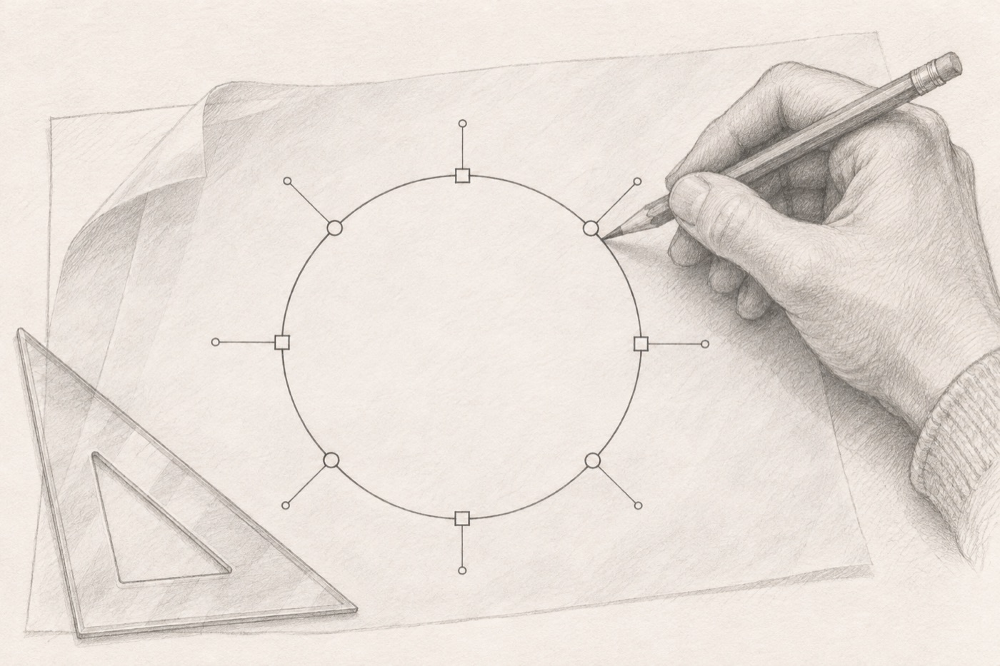

# Part 3: Shapes

<figure markdown="span">
  
  <figcaption>An outline is points, and the lines between them.</figcaption>
</figure>

The client wants more letters.

Halfmoon's publisher is planning Polish and Czech editions, and Plum can't set them yet. Before Mira can add a letter with a script, she has to know what a letter is made of. So this part opens a glyph and looks inside: contours, nodes, handles, and the glyphs that are built from other glyphs.

Then you draw. You make a box with a pen, a circle with curves and a row of dots with a loop. You move, scale and copy outlines. In the second half you take components and anchors apart, and build accented letters from a list of recipes.

Oskar's sheet has eleven lines. Four were crossed out by the end of Part 2:

- Count the glyphs and tell Ines.
- Find the glyphs that are still empty.
- Make a table of every glyph and its width.
- When the small caps come: list every glyph whose name ends in `.sc`.

Seven are open, and this part does the first two and the fourth of them:

- List the glyphs that are built from other glyphs.
- Mark every glyph that mixes its own outlines with borrowed ones.
- Make the left sidebearing of the *d*, *q* and *g* match the *o*.
- Rebuild the accented letters from the base letters and the accents.
- Find kerning pairs that are larger than they should be.
- Put the right family name and version number into every weight.
- Export the whole family to a dated folder every Friday.

You need the toolbox from Part 2: `halfmoon.py`, the practice copy of Plum, and Fly installed in FontLab 9.
