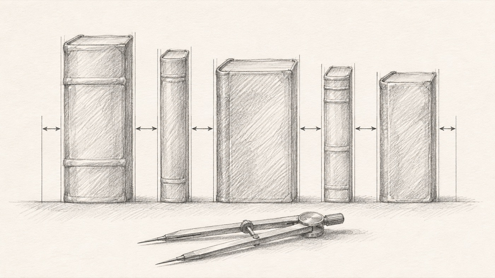

# Part 4: Space

<figure markdown="span">
  
  <figcaption>Every letter brings its own white with it.</figcaption>
</figure>

The proofs look uneven.

The Czech and Polish fonts went out, and the publisher's typesetter wrote back within days. The new letters are fine. The Bold "looks gappy", mostly in chapter headings, and she can't say where. A script can't judge how a line looks. It can measure the white between every two letters, and that is where this part starts.

The first eight chapters are about sidebearings, the white that belongs to each glyph. You measure it, set it, copy it from one letter to its relatives, link it with a rule, give the figures one width, and find the glyph that doesn't fit its group. Then you open up the whole Bold.

The next eleven are about kerning, the corrections for single pairs. You read the pairs and the classes, build classes from a list, set a pair, find the largest and the smallest, look for pairs that point at glyphs that are gone, make a proof to read, send the table out to a reviewer as a spreadsheet, and turn the Bold's kerning down.

The last chapter gathers the checks of the part into one audit that you can run again after every change.

Oskar's sheet has four lines open when the part begins. This part crosses out two of them, in chapters 63 and 74:

- Make the left sidebearing of the *d*, *q* and *g* match the *o*.
- Find kerning pairs that are larger than they should be.

You need the small helpers from Part 2, which each chapter writes out again where it uses them, the practice copy of Plum with the letters Part 3 added, and Fly installed in FontLab 9.
