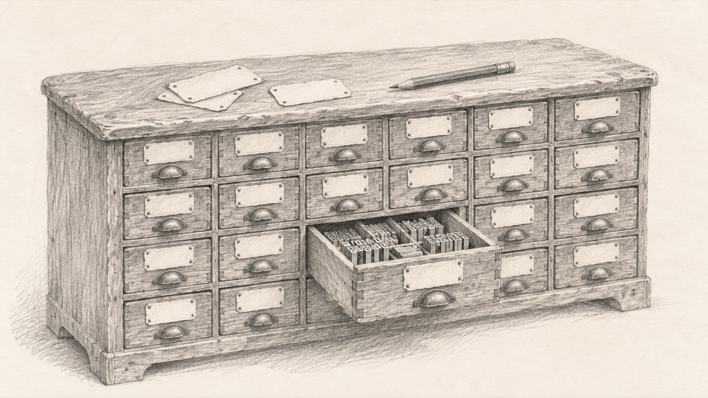

# Part 5: Words

<figure markdown="span">
  
  <figcaption>Every drawer needs a label somebody else can read.</figcaption>
</figure>

The font must work in real text.

The spacing is settled and the publisher is about to set whole books in Plum. A typesetter doesn't pick glyphs out of a grid. She types, and the font has to turn her typing into the right shapes: the letter she pressed, the small cap she asked for, the fraction in a recipe. When that fails, the cause is almost never a drawing. It's a name, a code or a line of feature text.

The first six chapters are about names and Unicode, the two labels every glyph carries. You check the names against the rules, derive each label from the other, find glyphs with two characters, ask which languages the font covers, and propose a better order for the Font window.

The next eight are about OpenType features. You read the feature text, write a small-caps feature by script, build features from glyph suffixes, make ligatures, keep classes up to date, write fractions, check the text before you compile it, and measure how much of the alphabet each feature covers. No call compiles features from Python, so the Compile button stays in your hand throughout.

Then five chapters on Font Info: the names, the vertical numbers, the version, the copyright line, and one settings file for a family delivered as several fonts.

The last chapter gathers the checks into one pre-flight, and lists the tests a person still does by hand.

Oskar comes back from his leave in the middle of this part, in chapter 93, three days a week. From then on he's in the room, with stories about what went wrong before anybody checked. His sheet has two lines open when the part begins. This part crosses out one of them, in chapter 100:

- Put the family name and the version in every weight.

You need the toolbox from Part 2 (`halfmoon.py`), the practice copy of Plum as Part 4 left it, and Fly installed in FontLab 9. That copy has 251 glyphs: Plum's 205, the fifteen with a suffix from Part 2, and the thirty-one accented letters and accents Part 3 built. The counts in this part are for that font. If you closed it without saving at the end of chapter 60, your counts are lower by thirty-one wherever glyphs or characters are counted, and chapter 91 will find four capitals missing from a class where I find nineteen. Nothing in this part was run in FontLab 9 by me. Each chapter says how its outputs were computed.
