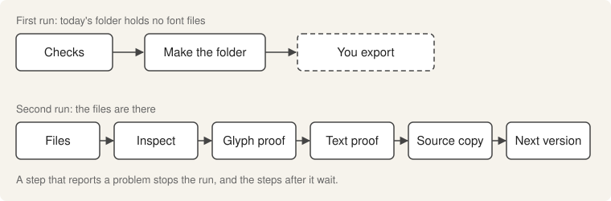

# 119. The Friday build

Friday of week twenty-three. On Oskar's sheet one line is still open: *Export the whole family to a dated folder every Friday.*

Mira has every piece of it. `ship_check.py` says whether the font may go. `export_family.py` says whether ten files arrived. `inspect_export.py` reads them. Two scripts write proofs. `bump_version.py` gives the font its next number. Six scripts, and on a Friday afternoon she is the one who has to remember them, in order, and not carry on when one of them says no.

Remembering an order is work for a script. Today you write the one that calls the others.

## What you need

- `Plum-practice` open in FontLab 9 and saved, with Fly installed.
- The scripts from chapters 97, 112, 114, 115, 116 and 118, and `halfmoon.py`.

I couldn't run the code in FontLab 9. I ran today's script and the six it calls in plain Python, with stand-ins for FontLab and with font files I built myself, through a whole Friday: a refusal, a first half, an export and a second half. Every block of output below comes from those runs.

## Step 1: A build has a hole in the middle

Nothing I've found lets a script press **Export Font As** with settings I can vouch for. Chapter 111 said so and nothing has changed. So the build can't be one run. It's two, with you in between:

1. Check the font. Make today's folder. Stop.
2. You export.
3. Check the files, inspect them, write the proofs, keep a copy of the source, give the font its next number.

One script can do both halves if it can tell which one is due. It can, from the disk: if today's folder for this version holds no font files, it's the first half. If it holds some, the export has happened, and it's the second.

That's a better signal than a setting at the top of the script, because nobody has to remember to change it.

<figure markdown="span">
  
  <figcaption>Two runs, with the export between them.</figcaption>
</figure>

## Step 2: Teach six scripts to answer

Each of the six ends by printing. `ship_check.py` prints `Not ready.` and you read it and stop. A script that calls `ship_check` can't read. Printing tells a person. To tell another script, a function has to `return` something.

So make the same three changes to each of the six.

First, move it out of the Scripts folder to the folder where `halfmoon.py` lives, as chapter 114 did with `preflight.py`, so it can be imported.

Second, change its last line from `main()` to chapter 114's guard, so that importing it doesn't run it:

```python
if __name__ == "__main__":
    main()
```

Third, add one line at the very end of its `main`, after the last `print`, indented four spaces so that it belongs to `main` and to nothing inside it:

| Script | Last line of `main` |
| --- | --- |
| `ship_check.py` | `return total + broken` |
| `export_family.py` | `return missing` |
| `inspect_export.py` | `return problems` |
| `proof_html.py` | `return 0` |
| `proof_text.py` | `return 0` |
| `bump_version.py` | `return 0` |

The rule is the same for all six: `main` returns the number of things wrong, and 0 means go on. In `inspect_export.py` the `return` goes after the `if shown is not None:` block and not inside it.

Each of those `main` functions also has early exits, a bare `return` after "Open a font first." and the like. Leave them. A bare `return` gives back `None`, and you'll see in a minute why that's the right answer for them.

Once a script has moved, it's no longer in the Scripts menu. To run one alone, type two lines in the Scripting panel: `import proof_text`, then `proof_text.main()`.

## Step 3: The mistake

Mira's first build called the steps in a loop and wrote down what each said:

```python
def run_steps(steps):
    for label, step in steps:
        result = step()
        log(f"{label}: {result}")
```

She tried it on a folder where one file hadn't arrived, the Medium TTF:

```text
>> Second half, for 2026-12-18-v1.003
  MISSING  GG Plum Medium .ttf
10 wanted, 9 there, 1 missing.
>> Files: 1
5 files, 0 problems.
Features in the last file: cpsp dnom frac kern liga numr smcp ss01 zero
>> Inspect: 0
Proof of otf/GGPlum-Regular.otf
235 glyphs with a character, 39 without.
Wrote /Users/mira/Halfmoon/exports/2026-12-18-v1.003/proof-glyphs.html
>> Glyph proof: 0
5 styles, 45 lines of text.
Wrote /Users/mira/Halfmoon/exports/2026-12-18-v1.003/proof-text.html
>> Text proof: 0
>> Source copy: 0
Version 1.003 -> Version 1.004
Note line for 3 masters: 2026-12-18: Version 1.004
6 fields changed.
>> Next version: 0
>> Build finished.
```

The second line says a file is missing. The fourth records it: `Files: 1`. And then the build carried on, wrote proofs into an incomplete folder, and gave the font its next number, which marks 1.003 as shipped. `Build finished.` is the last thing on the screen, and on a Friday afternoon the last line is the one that gets read.

She had made the steps answer and then not listened. A build has to stop at the first answer that isn't 0:

```python
def run_steps(steps):
    for label, step in steps:
        result = step()
        if result != 0:
            log(f"{label}: stopped the build ({result})")
            return False
        log(f"{label}: ok")
    return True
```

`run_steps` now answers too: `True` when every step passed, `False` when one stopped it.

The test is `!= 0`, not `> 0`, on purpose. A step that left through one of its early exits returns `None`. `None` isn't 0, so the build stops there too. A step that didn't say how it went is treated as one that went badly.

## The whole script

```python
#FLM: Friday Build
# Run it twice. The first run checks the font and makes today's folder.
# You export. The second run checks the files, writes the proofs, keeps
# a copy of the source and gives the font its next version number.
import shutil
from datetime import datetime
from pathlib import Path

import bump_version
import export_family
import fly.ap.core.scripting as scripting
import halfmoon
import inspect_export
import proof_html
import proof_text
import ship_check
from fly import fl

LOG = []


def log(line):
    stamped = f"{datetime.now():%Y-%m-%d %H:%M} {line}"
    LOG.append(stamped)
    print(">>", line)


def keep_source():
    font = fl.CurrentFont()
    folder = export_family.export_folder(font, scripting.current_package())
    shutil.copy(font.path, folder / Path(font.path).name)
    return 0


BEFORE = [("Checks", ship_check.main)]
AFTER = [
    ("Files", export_family.main),
    ("Inspect", inspect_export.main),
    ("Glyph proof", proof_html.main),
    ("Text proof", proof_text.main),
    ("Source copy", keep_source),
    ("Next version", bump_version.main),
]


def run_steps(steps):
    for label, step in steps:
        try:
            result = step()
        except Exception as problem:
            log(f"{label}: DID NOT RUN: {type(problem).__name__}: {problem}")
            return False
        if result != 0:
            log(f"{label}: stopped the build ({result})")
            return False
        log(f"{label}: ok")
    return True


def font_files(folder):
    return [p for p in folder.rglob("*") if p.suffix.lower() in export_family.FORMATS]


def build(font, package):
    folder = export_family.export_folder(font, package)
    if not folder.exists() or not font_files(folder):
        log(f"First half, for {folder.name}")
        if not run_steps(BEFORE):
            return
        folder.mkdir(parents=True, exist_ok=True)
        log("Folder made. Waiting for the export.")
        print("Save the font. Then File > Export Font As, with chapter 112's")
        print(f"settings, into {folder}")
        print("Then run this script again.")
        return
    log(f"Second half, for {folder.name}")
    bump_version.DRY_RUN = False
    try:
        finished = run_steps(AFTER)
    finally:
        bump_version.DRY_RUN = True
    if finished:
        log("Build finished.")
        print("The font has its next number. Save it.")


def main():
    font = fl.CurrentFont()
    if font is None or not font.path:
        halfmoon.tell("Open a saved font first.")
        return
    exports = Path(font.path).parent / "exports"
    exports.mkdir(exist_ok=True)
    try:
        build(font, scripting.current_package())
    finally:
        with open(exports / "build-log.txt", "a", encoding="utf-8") as f:
            f.write("\n".join(LOG) + "\n")


main()
```

Save it as `friday_build.py` in the Scripts folder. This one you run yourself, so it ends in a plain `main()`.

Notes on the listing, before the runs.

`BEFORE` and `AFTER` are lists of pairs, a label and a function. `ship_check.main` has no brackets after it. With brackets Python would call it on the spot, while the list is being made. Without them the list holds the function itself, to be called later by `step()`. Chapter 100's `CHECKS` worked the same way.

`log` does two things with one line. It prints it with `>>` in front, so the build's own lines stand out from what the six scripts print. And it keeps it in `LOG` with the date and time. `datetime.now()` is the moment it's called, and the part after the colon in the braces is a pattern for writing it: `%Y` the year, `%m` the month, `%d` the day, `%H` and `%M` the hour and minute.

`main` writes `LOG` to `build-log.txt` in a `finally` block, chapter 95's, so the file gets its lines when the build stops early and when something crashes. The `"a"` where you've always written `"w"` means append: add to the end of the file and keep what's there. A log that started fresh each run would lose the run that went wrong.

`bump_version.DRY_RUN = False` reaches into another module and sets its variable. The setting lasts as long as FontLab stays open, because a module is loaded once and kept. So the build puts the `True` back in a `finally`, whether the steps passed, stopped or crashed, and `bump_version.main()` run on its own afterwards still only rehearses. The build is the one place that has earned the real thing, since by that line everything else has passed.

`keep_source` does what chapter 117 asked for: a copy of the font file goes in beside the exports, so next month there's an old font to compare with. It copies the file as last saved. A script can't see changes you haven't saved, which is why the first half ends by telling you to save.

Python has a module called `logging` that does what `log` does and much more. I haven't seen how it behaves inside FontLab, where the screen it writes to isn't an ordinary one, so the book uses a few lines it can explain.

## A Friday, run by run

The font is at 1.002. Run the build:

```text
>> First half, for 2026-12-18-v1.002
Glyph names   274 looked at   ok
Unicode       235 looked at   ok
Features       35 looked at   ok
Font Info       5 looked at   ok
Metrics         8 looked at   ok
Masters       201 looked at   ok
Figures        10 looked at   ok
Kerning       105 looked at   ok
New version     1 looked at   1 problems
    2026-12-10-v1.002 already holds files
9 checks, 1 problems, 0 did not run.
Not ready.
>> Checks: stopped the build (1)
```

It stopped at its first step, and it was right to. Version 1.002 went to the publisher last week. Mira runs `bump_version.main()` by hand, with `DRY_RUN` off, for the last time. Then the build again:

```text
>> First half, for 2026-12-18-v1.003
```

followed by nine lines of `ok`, and:

```text
9 checks, 0 problems, 0 did not run.
Ready to export.
>> Checks: ok
>> Folder made. Waiting for the export.
Save the font. Then File > Export Font As, with chapter 112's
settings, into /Users/mira/Halfmoon/exports/2026-12-18-v1.003
Then run this script again.
```

She saves, exports, and runs it a third time. The folder holds font files now, so the script takes the other road:

```text
>> Second half, for 2026-12-18-v1.003
  ok       otf/GGPlum-Light.otf
```

and nine more of those, then:

```text
10 wanted, 10 there, 0 missing.
>> Files: ok
```

Then the five lines of `inspect_export.py` and `>> Inspect: ok`, the two proofs with an `ok` each, and the end:

```text
>> Source copy: ok
Version 1.003 -> Version 1.004
Note line for 3 masters: 2026-12-18: Version 1.004
6 fields changed.
>> Next version: ok
>> Build finished.
The font has its next number. Save it.
```

The folder holds `otf`, `ttf`, `Plum-practice.vfj` and two proof pages. And `build-log.txt`, one level up, holds the day:

```text
2026-12-18 15:40 First half, for 2026-12-18-v1.002
2026-12-18 15:40 Checks: stopped the build (1)
2026-12-18 15:40 First half, for 2026-12-18-v1.003
2026-12-18 15:40 Checks: ok
2026-12-18 15:40 Folder made. Waiting for the export.
2026-12-18 16:05 Second half, for 2026-12-18-v1.003
2026-12-18 16:05 Files: ok
2026-12-18 16:05 Inspect: ok
2026-12-18 16:05 Glyph proof: ok
2026-12-18 16:05 Text proof: ok
2026-12-18 16:05 Source copy: ok
2026-12-18 16:05 Next version: ok
2026-12-18 16:05 Build finished.
```

The times are my stand-in's. The counts are the reader's font as the book has built it, and yours will be your own.

The bump comes last, and that changes what the number on the font means. From today the font on the desk is always one number ahead of the last one shipped. Work done on Monday is done on 1.004, and next Friday's first run passes the version check with nobody thinking about it. Chapter 97 said the Friday build would call the bump. This is the call.

The second half doesn't run the checks again. It can't: the *New version* check would find today's own files and refuse.

Oskar takes the sheet off the wall and draws the eleventh line. He doesn't put it back.

## Break it on purpose

Take `return missing` out of `export_family.py` again and run the second half on a complete folder:

```text
10 wanted, 10 there, 0 missing.
>> Files: stopped the build (None)
```

Ten of ten, and the build stopped. `main` reached its end without a `return`, gave back `None`, and the build won't take silence for a yes. It's a nuisance and it's the right way round. The other way, a step you forgot to finish would pass every Friday. Put the line back. Because the module is already loaded, FontLab keeps the old one until you restart or use chapter 33's `importlib.reload`.

Now, in `AFTER`, misspell a function: `proof_html.mian`. Run:

```text
AttributeError: module 'proof_html' has no attribute 'mian'
```

as the last line of a traceback, before any step ran. The list is built when the script is read, so a wrong name there fails at once. That's the good kind of failure. An error inside a step, while it runs, is caught by `run_steps` and becomes a `DID NOT RUN` line in the log, and the build stops there.

## What you learned

A function that prints tells a person and a function that returns tells a script, so a script that others will call needs a `return` with a meaning, and here it's the number of problems. A build is a list of labelled functions run in order that stops at the first answer other than 0, and treats no answer as a bad one. What can't be scripted, the export, sits between two runs, and the script decides which half is due from what's on the disk. A log file opened with `"a"` and written in `finally` keeps the record of the runs that failed, which are the ones you'll want to read.

## Try it yourself

1. The second half is chosen by today's date in the folder name. Start a build at five to midnight, export after midnight, and say what the next run does. Then say what you'd do about it by hand.
2. Add a step after "Source copy" that calls chapter 117's `font_diff` when a second font is open, and returns 0 either way.
3. Run the build a fourth time, after `Build finished.` What does it make, and is it harmful?

## Next

Five weights are in the folder. The art director asked for nine, and chapter 107 said four of them lie outside what three masters can reach. Chapter 120 closes Part 6 with a release list written as code, and with an honest count of what shipped.
