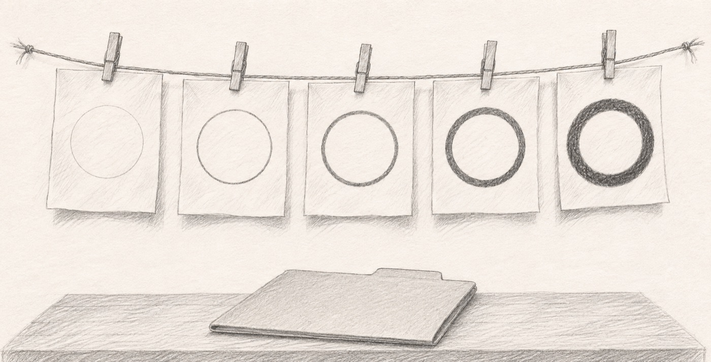

# Part 6: Families

<figure markdown="span">
  
  <figcaption>One drawing, five weights.</figcaption>
</figure>

One font becomes five, and the five leave the building.

It's week twenty. The art director has seen the Regular and the Bold and wants what lies between them, and a good deal that doesn't: nine weights, for the rest of the cookbook series. Plum has three drawings, a Light, a Regular and a Bold. Everything in this part follows from that sum.

The first four chapters look at what "three drawings of one font" means to a script. You list the masters, check that every glyph is built the same way in each, find the contours that start at different points, and lay the widths side by side.

The next six work between the masters. You copy anchors and kerning from the one you trust to the others, do the arithmetic of a weight halfway between two drawings, read the axis, plan the instances, and blend one new drawing of the figures.

Then three chapters get files out of FontLab: one style, then the family, then a folder of Oskar's old fonts opened and closed again without a mark.

Five chapters distrust the result. A check before anything ships, two proof pages, a list of what changed since last week, and a second opinion from fontTools, which reads the exported file and knows nothing of FontLab.

The last two put it together. One script runs the Friday, and one says whether the release is finished.

Oskar's sheet had one line left when this part began:

- Export the whole family to a dated folder every Friday

It's crossed out in chapter 119.

Three things in this part a script doesn't do, and each chapter says so where it matters. The export itself is done by hand in **File > Export Font As**, with scripts on both sides of it. The instances are typed into Font Info from a line a script prepares. And five weights ship, not nine: the other four need drawings nobody has made.

You need the toolbox from Part 2 (`halfmoon.py`), the practice copy of Plum as Part 5 left it, and Fly installed in FontLab 9. Nothing in this part was run in FontLab 9 by me. Each chapter says how its outputs were computed.
