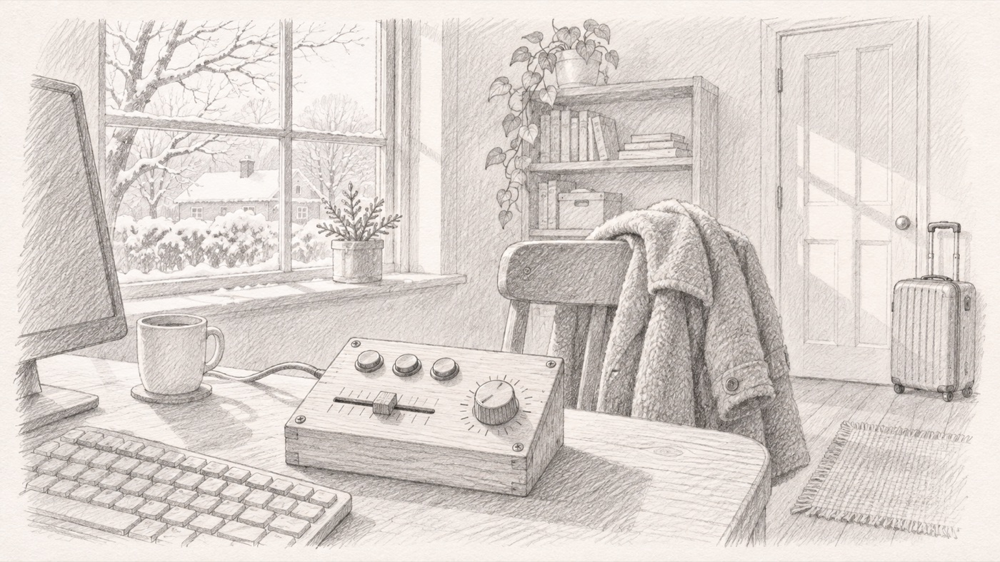

# Part 7: Tools

<figure markdown="span">
  
  <figcaption>A tool for somebody who wasn't there when you made it.</figcaption>
</figure>

Mira makes tools for other people.

It's week twenty-four, the week before Christmas. Oskar is on holiday until January, Mira has a train to catch, and Ines is alone with a font and a folder of scripts she has never run. A script you wrote for yourself can assume you know what it needs. A tool for somebody else has to ask for it, in a window, and has to behave when she clicks the wrong thing.

The first six chapters build a window: a label, buttons that do something, a box for a number, a layout that holds when the window is stretched, a list to pick from. The sixth is the chapter on classes, which the book has put off until now. A window with more than three things in it needs one.

The next five make the window into a tool. It becomes a panel that stays open beside the font, follows the glyph you're looking at, remembers its settings in a file, shows progress on a long job, and puts each click into Edit > Undo as one step.

Two chapters deliver it: into FontLab's menus, and then into a folder with an installer, for a studio in Porto that has never seen your disk.

Then five chapters look outward. You draw numbers on the Glyph window's canvas. You read a script written for another font editor and find out how much of it runs here. You write a report that runs in more than one editor. You run the Friday build from the Terminal with FontLab as the server, and you have FontLab photograph its own windows for the release notes.

Chapter 139 tests your functions with FontLab closed. Chapter 140 is Oskar's first morning back, and the list Mira wrote for him.

Oskar's sheet has no lines left. The work in this part comes from the people who now use Mira's scripts: Ines, Rita in Porto, Tove with her other editor, and a friend with a script from somewhere else.

Two chapters break the rule that every sample imports through `fly`, and each says why: chapter 137's script runs outside FontLab, and chapter 138 calls a tool Fly has no name for.

You need the practice copy of Plum as Part 6 left it, and Fly installed in FontLab 9. I ran nothing in this part in FontLab 9. Windows, panels, menus and the canvas are the things I could check least, and each chapter says what was computed outside FontLab and what you'll be the first to see. Chapter 139 is the exception: all of its output is real.
